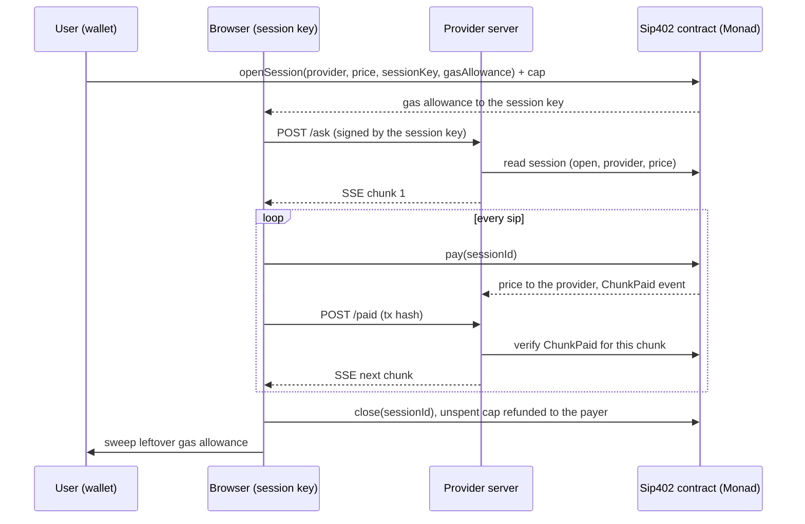

# Sip402

**Pay for AI by the sip.**

Sip402 streams an AI answer chunk by chunk and settles every chunk on Monad before the next one is sent. You approve one spending cap in your wallet; a temporary session key then pays for each ~10-word "sip" as you read it. Pause, resume or cancel at any moment: you pay only for the sips you read, the unspent cap is refunded by the contract, and leftover gas is returned to your wallet.

## Live demo

**https://sip402-one.vercel.app**

- Network: Monad Testnet. Use an injected wallet such as Rabby, funded with testnet MON from the Monad faucet.
- Recommended for a first try: the **Fast** tier with **up to 10 sips**.
- The provider server runs on a free tier and may take ~30–60 s to wake up on first use.

Demo video: _coming soon_

## The problem

AI is paid up front: monthly subscriptions or prepaid credits. You pay the same whether the answer is brilliant or useless, and two agents that have never met have no way to set up billing between them at all.

## How it works

1. **Open a session.** One wallet approval calls `openSession`, which deposits a spending cap plus a gas allowance and authorizes a temporary session key that lives only in the browser's memory.
2. **Stream.** The provider streams the answer over SSE in chunks of about 10 words.
3. **Pay per sip.** For each chunk, the session key calls `pay()` on Monad. The provider verifies the `ChunkPaid` event on-chain and only then sends the next chunk.
4. **Pause / Resume / Cancel.** Pause stops payments while the session stays open; Resume continues the same answer without a wallet prompt; Cancel ends it.
5. **Close and sweep.** `close()` refunds the unspent cap to the payer, then a sweep sends the session key's leftover gas allowance back to the wallet.



## Why Monad

Payment is tied to the content flow, so every sip waits for a confirmed transaction. That only feels like streaming if confirmations are faster than reading.

- Measured send-to-receipt time in our testnet sessions averaged about 330–360 ms (one run averaged 458 ms on the public RPC).
- A 9-payment session spends about 3 s waiting for confirmations, versus about 108 s estimated with one payment per 12 s Ethereum block.

The app measures this live in the browser and shows it next to a labeled 12-second-block Ethereum estimate.

## Features

- **Price tiers**: Fast (0.0001 MON per sip), Smart (0.0003) and Pro (0.0005), locked while a session is active.
- **Sip cap**: choose up to 10, 20 or 30 sips; the deposit is sips × tier price.
- **Live payment feed**: one row per sip with amount, confirmation time and a MonadVision link, plus a pending row while a payment is in flight.
- **Session summary**: deposit, opening fee, refund, returned gas and net cost, broken down into provider payments, network fees and dust, each linked to its transaction. The numbers are checked to add up.
- **Metrics panel**: payment count, average and last confirmation time, chunk price, average network fee, and the Ethereum speed comparison.
- **Agent mode**: `npm run agent` runs an autonomous agent that opens a session with its own wallet, pays per sip from the terminal and stops as soon as the answer contains what it needs (`--stop-when "<keyword>"`) or the sip cap is reached. See [NOTES.md](NOTES.md).

## Architecture

- **Contract** (Foundry, Solidity): `openSession`, `pay`, `close` and `remaining`. Sessions are packed into three storage slots; `pay()` only bumps a counter and forwards the chunk price to the provider.
- **Provider server** (Node, Express): checks the session on-chain and the session key's signature, splits the answer into chunks, streams them over SSE and releases each next chunk only after verifying its `ChunkPaid` event. Paused streams are kept for 5 minutes of inactivity.
- **Frontend** (Next.js, viem): wallet connection, session key, per-sip payments via `eth_sendRawTransactionSync`, Pause/Resume/Cancel, close, sweep, live feed, metrics and summary.
- **shared/**: chain config and measured gas limits, the contract ABI, the request-signing format, and an RPC transport that retries the public RPC's rate-limit errors with exponential backoff (with an optional fallback RPC).

```
src/            Sip402.sol
test/           Forge tests
script/         Deploy script, ABI export, local end-to-end test runner
server/         Provider server
web/            Next.js app
shared/         Code shared by server, web and agent
agent/          Agent mode demo
```

## Contract

`Sip402` on Monad Testnet (chain 10143): [`0x0654aB49C0AF16c0E660E84A8A879e497095a6D8`](https://testnet.monadvision.com/address/0x0654aB49C0AF16c0E660E84A8A879e497095a6D8), verified on MonadVision.

## Run locally

```shell
npm install
cp server/.env.example server/.env   # set PROVIDER_ADDRESS
npm run server                       # provider on http://localhost:3001
npm run web                          # app on http://localhost:3000
```

Tests:

```shell
forge test                 # contract tests
./script/e2e-local.sh      # end-to-end cases against a local anvil chain
```

Agent mode: see [NOTES.md](NOTES.md). Deployment (Render for the server, Vercel for the web app): see [DEPLOY.md](DEPLOY.md).

## Design trade-offs and roadmap

One on-chain transaction per sip keeps both sides' risk to at most one unpaid chunk and needs no payment channel. The cost is that network fees dominate on testnet: at Monad's 100 gwei minimum base fee, a `pay()` needs about 55k gas, which is far more than a 0.0001 MON sip.

Next:

- Signed off-chain vouchers per sip with a single on-chain settlement, so fees no longer scale with the number of sips.
- Plug in a real streaming LLM as the provider.

## Limitations

- The AI provider is mocked: answers are pre-written and chosen by keywords in the question.
- The tiers differ only in price and label, not in model quality.

---

Built at Monad Blitz Ankara, 24 October 2026.
